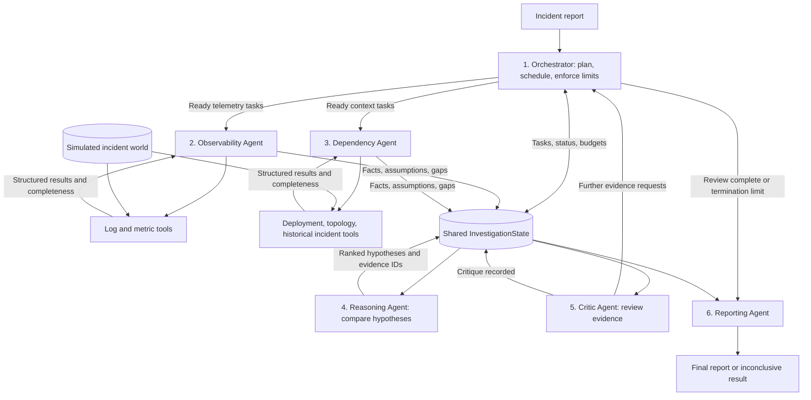

# Architecture diagram and agent coordination

The system uses six logical agents coordinated by a supervisor and an in-memory
shared investigation state. All agents run in one Python process using `asyncio`.
They may share the same LLM client; separate agents do not require separate models
or servers. The diagram describes the current implementation.

## Architecture diagram



Solid arrows show control or data flow. Observability and Dependency tasks can
run concurrently when their dependencies are satisfied. Reasoning and Critic run
after the ready evidence-gathering work for a round finishes. Reporting runs when
the Orchestrator terminates the investigation. Shared state and tools are
infrastructure, not additional agents.

## Agent responsibilities

| Agent | Input | Responsibility | Output |
| --- | --- | --- | --- |
| Orchestrator | Incident, configuration, Critic requests | Generate a task plan, schedule work, manage retries and termination | Tasks and final termination reason |
| Observability | Service/time-window task | Retrieve logs/metrics and interpret error patterns and anomaly timing | Findings and evidence gaps |
| Dependency | Change/topology/history task | Retrieve and interpret deployments, configuration changes, service connections, and past incidents | Context findings and evidence gaps |
| Reasoning | Shared evidence, previous hypotheses, previous critique issues | Develop and compare competing causal explanations | Ranked hypotheses with supporting/contradicting citations, assumptions, and confidence |
| Critic | Incident, hypotheses, evidence, gaps | Challenge missing timing, weak support, alternative causes, and incomplete data | Issues and targeted investigation requests |
| Reporting | Ranked hypotheses, cited evidence, latest issues, termination reason | Determine the configured outcome and generate the summary/actions | Structured FinalReport |

## How coordination works

1. **Initialize.** `Orchestrator.investigate()` creates one `InvestigationState`
   and passes it to the specialist agents. The incident includes the affected
   service and reported time; the configuration determines the investigation window.
2. **Plan.** `_plan()` asks the LLM for structured task specifications. Task kind
   restricts ownership: logs/metrics belong to Observability; topology, changes,
   and historical incidents belong to Dependency.
3. **Schedule.** `_run_ready()` selects pending tasks whose prerequisites have
   finished. It runs batches up to `max_parallel` with `asyncio.gather()`.
   `_execute()` dispatches each task through `self.workers[task.agent]`.
4. **Gather and share.** Workers call the existing `ToolBox`. Results include
   data and a completeness status. The workers interpret them using their role
   prompts and write findings to shared state, receiving IDs such as `E1`.
5. **Reason.** The Reasoning Agent reads a state snapshot, forms competing
   hypotheses, removes unknown evidence citations, and ranks candidates.
6. **Review.** The Critic reads those hypotheses and returns issues plus
   requests for evidence that could change the conclusion. It does not directly
   execute tools or assign work to another agent.
7. **Follow up.** `_enqueue()` converts valid Critic requests into pending tasks.
   The next round gathers additional evidence and reruns Reasoning and Critic.
8. **Report.** When a termination condition is reached, remaining pending tasks
   are marked skipped. Reporting creates the final report; the Orchestrator adds
   token, latency, tool-call, and task statistics and returns `(report, state)`.

Example task dependencies:

```text
T1 Dependency: discover checkout service connections
T2 Observability: query checkout logs                  independent
T3 Observability: query checkout metrics               independent
T4 Observability: query neighboring-service metrics    depends on T1
```

T1, T2, and T3 can run together. T4 uses T1's topology evidence to resolve its
service list. Dependencies that fail or are skipped count as finished, allowing
degraded execution; missing topology may cause a neighbor task to collect no data.
The scheduler waits for each entire batch before scheduling another batch.

## Structured agent communication

The [dataclasses](incident_agents/models.py) define the communication contracts:

| Contract | Contents |
| --- | --- |
| `Task` | ID, assigned agent, task kind, parameters, dependency IDs, attempts, status |
| `ToolResult` | Tool name, success, rows, completeness, error, attempts |
| `Evidence` | ID, originating task/agent, content, fact/assumption kind, category, service, timestamp, metadata |
| `Hypothesis` | Statement, service, category, confidence, supporting and contradicting evidence IDs, assumptions |
| `TaskRequest` | Agent, task kind, parameters, reason for additional work |
| `Critique` | Verdict, issues, follow-up requests |
| `FinalReport` | Outcome, summary, ranked hypotheses, facts, assumptions, issues, actions, statistics |

For example, the Critic may return:

```json
{
  "agent": "observability",
  "kind": "scan_metrics",
  "params": {"services": ["postgres-primary"], "start": 0, "end": 100},
  "reason": "Verify whether database saturation preceded payment timeouts"
}
```

This request changes the subsequent investigation. The system therefore has
stateful collaboration and a feedback loop rather than only a fixed prompt chain.
Identical task specifications and identical evidence records are deduplicated.

## Example investigation

For checkout timeouts, Observability may find payment errors occurring before
checkout symptoms. Dependency reveals the path
`checkout-api -> payment-service -> postgres-primary`. Reasoning compares a
checkout deployment regression with upstream database saturation. The Critic
requests database telemetry to distinguish these candidates. The Orchestrator
routes that request to Observability. New metrics can strengthen the database
hypothesis or contradict it; Reasoning updates its ranking before the next review.

This example illustrates possible decisions, not a guaranteed execution trace.
Actual tasks and hypotheses depend on the selected LLM and available evidence.

## Reliability and termination

Default multi-agent configuration in [state.py](incident_agents/state.py):

| Setting | Default |
| --- | --- |
| Parallel scheduled tasks per batch | 4 |
| Tool-call budget across agents, including attempts | 40 |
| Tool retries | 2 retries, up to 3 attempts |
| Task retries | 1 retry, up to 2 attempts |
| Tool timeout | 5 seconds |
| Worker-task timeout | 30 seconds per attempt |
| Feedback rounds | Initial round plus up to 3 follow-ups |
| Checked wall-clock budget | 120 seconds |

Timeouts trigger bounded tool retries with backoff; invalid tool inputs are not
retried by the tool wrapper. A worker-task failure can trigger an entire task
retry, potentially repeating earlier successful queries. Failed tasks record
evidence gaps. Reasoning failure keeps previous hypotheses. Narrative failure
in Reporting returns fallback text instead of discarding the structured report.

Termination occurs on Critic approval, maximum feedback rounds, tool/time budget
exhaustion, or failure to enqueue new follow-up work. The standalone Orchestrator
checks wall-clock limits between operations; it does not wrap its entire lifecycle
in a hard timeout. `compare_agents.py` supplies an outer deadline and matched
per-request timeouts, and overrides selected configuration values for benchmarking.

## Current implementation limits

- Critic verdict is `challenge` when valid follow-up requests exist, otherwise
  `approve`. Remaining issues without a request do not block approval.
- Critic failure currently becomes approval with a warning. Consequently,
  `critic_approved` can describe a fallback, not a successful review.
- Reporting declares a conclusive outcome when top confidence meets its threshold
  and the ranking margin is sufficient. Critical review issues do not independently
  block this decision. Confidence is not a calibrated probability.
- Existing evidence IDs are validated, but semantic support is not verified.
  Findings classified as facts by an LLM are not independently proven true.
- Planning resolves only dependencies whose keys were encountered earlier;
  complete graph validation and cycle detection should be added.
- State is in memory. Reusing one Orchestrator instance concurrently is unsafe
  because investigation state and workers are instance attributes.

These limitations describe current behavior; improved review gating, schema
validation, and failure accounting are proposed in the
[architecture comparison](architecture_comparison/README.md).

## Implementation and evaluation boundary

The [LLM adapter](incident_agents/llm.py) supplies the role prompts and Groq calls;
[MockLLM](incident_agents/mock_llm.py) substitutes deterministic rules offline.
[tools.py](incident_agents/tools.py) reads simulated JSON data; agents do not query
live production systems. The single-agent baseline uses one decision loop over
the same tools and has no specialist-agent coordination.

[compare_agents.py](compare_agents.py) loads dataset inputs and withheld answers.
Only the incident and tool access reach investigators. Ground answers are used
afterward to score reports. See [SETUP.md](SETUP.md) for runnable commands and
[synthetic/README.md](synthetic/README.md) for the dataset layout.
