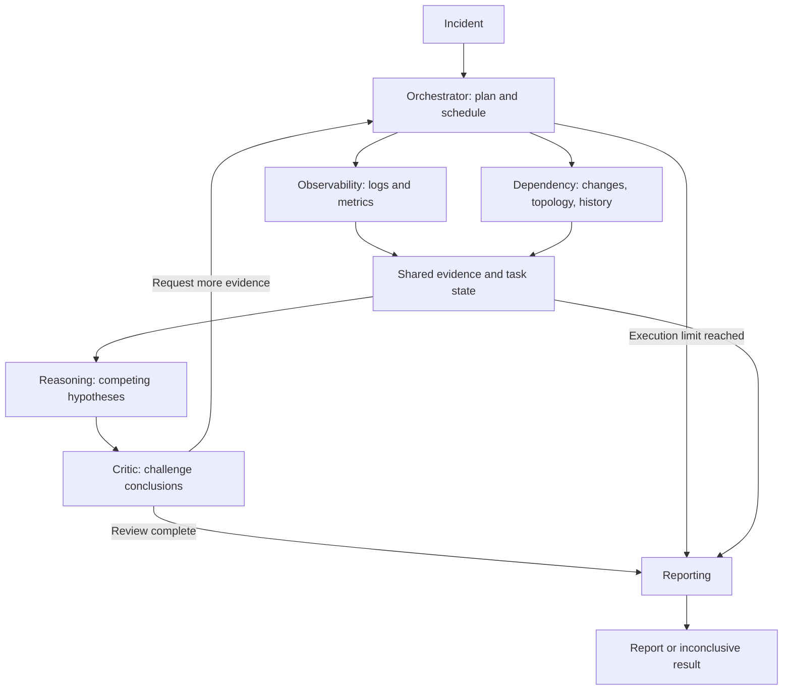
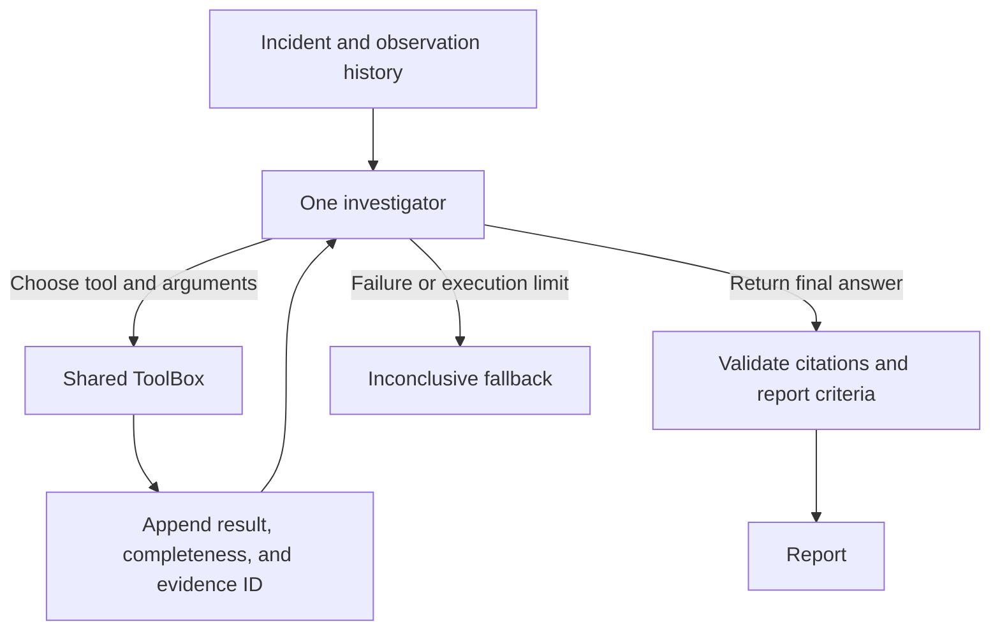

# Multi-agent versus single-agent incident investigation

This project implements two architectures using the same five investigation tools
and incident datasets. The saved runs show useful differences in execution, but
provider rate limits, incomplete runs, and category-label mismatches currently
prevent a reliable claim that one architecture is better at reasoning.

This document describes the implementation and saved results inspected on
24 October 2026. Proposed changes below are recommendations, not implemented fixes.

## Architecture and workflow

### Multi-agent



Six logical agents run in one Python application. Independent evidence-gathering
tasks run concurrently; dependent tasks wait for prerequisites. The Critic can
request additional tasks, which the Orchestrator schedules in another round.
Agents communicate through structured evidence, hypotheses, critiques, and tasks.

Implementation: [orchestrator.py](../incident_agents/orchestrator.py),
[agents.py](../incident_agents/agents.py), and
[state.py](../incident_agents/state.py).

### Single-agent



One LLM role plans queries, interprets results, compares explanations, reviews its
own reasoning, and writes the final answer. Each decision selects one tool call
or a final response. The full observation history is sent on subsequent decisions.
There are no specialist agents or separate Critic calls.

Implementation: [agent.py](../single_agent/agent.py),
[llm.py](../single_agent/llm.py), and
[config.py](../single_agent/config.py).

Both architectures use the exact same [ToolBox](../incident_agents/tools.py):
`query_logs`, `query_metrics`, `get_deployments`, `get_dependencies`, and
`search_past_incidents`. These tools query simulated data and reproduce seeded
timeouts, empty responses, and partial results. Both use the same Groq adapter
when `--llm groq` is selected. Mock mode uses different deterministic policies;
its results measure those policies and orchestration, not model reasoning quality.

## Design trade-offs

| Design choice | Multi-agent | Single-agent | Consequence |
| --- | --- | --- | --- |
| Responsibility | Separate evidence collection, reasoning, review, and reporting | One role owns all decisions | Specialists are easier to inspect individually; a single role has fewer handoffs |
| Evidence collection | Independent tasks run in parallel | One tool request per decision | Parallel work can reduce elapsed time but produce bursts of API requests |
| Context | Specialists receive role-specific input; reasoning receives accumulated findings | Repeatedly receives the raw observation history | Focused contexts can reduce repeated raw-data tokens; summaries can lose important detail |
| Review | Separate Critic requests targeted follow-up work | Investigator reviews its own explanation | A separate review role can expose gaps, but the same model may repeat the same biases |
| Cost | Coordination and review add model calls | Fewer role transitions, but potentially many sequential decisions | Neither architecture is guaranteed to use fewer calls or tokens |
| Reliability | Agent-specific recovery and task status | One bounded decision loop | Multi-agent recovery is more complex; a single-agent failure can interrupt the entire reasoning loop |
| Debugging | Task/evidence IDs identify the failing stage | One observation history shows the decision sequence | Multi-agent has more components; single-agent has fewer explicit responsibility boundaries |
| Deployment | One process with shared in-memory state | One process with local investigation state | Neither currently provides durable recovery after a process crash |

## What the saved Groq runs show

The following values come from the saved per-case summaries under
[`results/synthetic_groq`](../../results/synthetic_groq). They cover four
available completed case pairs, not the entire twelve-case dataset. Their recorded
model is `qwen/qwen3.8-27b`.

| Case | Architecture | Root-cause correctness | Ground-truth correctness | Tool attempts | Latency, seconds | Recorded tokens |
| --- | --- | --- | --- | --- | --- | --- |
| SYN-003 | Multi-agent | 1 | 1 | 15 | 333.84 | 37,847 |
| SYN-003 | Single-agent | 0 | 0 | 0 | 21.32 | 0 |
| SYN-004 | Multi-agent | 1 | 1 | 12 | 289.32 | 28,850 |
| SYN-004 | Single-agent | 0 | 0 | 20 | 600.00 | 72,885 |
| SYN-005 | Multi-agent | 0 | 0 | 7 | 117.40 | 13,007 |
| SYN-005 | Single-agent | 0 | 0 | 1 | 17.70 | 580 |
| SYN-006 | Multi-agent | 0 | 0 | 6 | 4.77 | 766 |
| SYN-006 | Single-agent | 0 | 0 | 0 | 0.49 | 0 |

Source summaries: [003](../../results/synthetic_groq/inc_003/summary.json),
[004](../../results/synthetic_groq/inc_004/summary.json),
[005](../../results/synthetic_groq/inc_005/summary.json), and
[006](../../results/synthetic_groq/inc_006/summary.json).

These observations need qualification:

- **SYN-003:** Multi-agent identified database resource exhaustion. Its event log
  also contains rate-limit errors. Single-agent stopped with `RateLimitError`
  before collecting evidence. This is not a completed reasoning comparison.
- **SYN-004:** Multi-agent identified cache resource exhaustion. Single-agent
  reached the overall deadline after 20 tool attempts. Its history repeatedly
  consumed context without producing a final answer; that is an execution issue
  worth investigating, not proof that single-agent reasoning cannot solve the case.
- **SYN-005:** Multi-agent identified the expired external gateway certificate and
  the correct service, but returned `external_dependency_failure` instead of the
  expected `dependency_failure`. Strict category matching scored it incorrect.
  Single-agent encountered a rate limit after one tool call.
- **SYN-006:** Both runs failed to produce hypotheses amid provider rate limits.
  Very low latency and token totals here indicate incomplete work, not efficiency.

No overall architecture winner should be inferred from these four pairs. Rerun
under comparable provider availability before comparing completed investigations.
Historical result files are snapshots and can change when cases are rerun.

## Metrics and interpretation

| Metric | Current definition | Limitation |
| --- | --- | --- |
| Root-cause accuracy | Top hypothesis service and category exactly match ground truth, averaged over conclusive-target cases | Label synonyms fail; provider-blocked runs currently count as incorrect |
| Ground-truth accuracy | Expected outcome matches; conclusive targets also require the correct top service and category | Same criterion as case-success rate; does not compare full narrative meaning |
| Evidence grounding | Valid cited IDs divided by valid plus invalid citations, including citations removed by validation | Reference-validity proxy only; an existing citation may not support its claim |
| Tool-call count | Attempted tool calls, including retries | More calls may represent useful follow-up or waste; inspect the evidence acquired |
| Latency | Per-run elapsed time; arithmetic mean in aggregate | Rate limits, retry waits, and incomplete runs affect interpretation |
| Token consumption | Recorded input plus output tokens | Failed/canceled provider usage may be absent; mock counts are estimates |

Per-incident correctness is binary (0 or 1); an average across incidents can lie
between 0 and 1. Confidence is a separate model score and is not measured accuracy.
An evidence-grounding proxy of 1 does not establish that the conclusion is true.
The current aggregate error count captures unhandled exceptions, so it can miss
provider failures converted into fallback reports.

## Recommended improvements, in priority order

| Priority | Change | Why it helps | Trade-off |
| --- | --- | --- | --- |
| 1 | Record provider failures centrally and distinguish completed, blocked, timed-out, and model-error runs | Prevents infrastructure outages from being mistaken for reasoning failures | Requires additional run-status tracking and explicit benchmark denominators |
| 1 | Add a shared request/token limiter and respect provider retry delays within the global deadline | Reduces bursts and repeated 429 failures; coordinates requests across agents | Adds waiting time and may reduce parallelism |
| 1 | Report both end-to-end success and accuracy among completed runs, with completion counts | Makes reliability visible without hiding failures or overstating reasoning quality | More than one headline number is required |
| 1 | Constrain cause categories with a shared enum/schema; define allowed aliases before evaluation | Avoids SYN-005-style label mismatches while preserving strict reproducible scoring | A fixed taxonomy may omit valid mechanisms; aliases must not be chosen after seeing scores |
| 1 | Replace Critic failure's `approve` fallback with `review_unavailable` and preserve that status in Reporting | Prevents failed review from being labeled approval | More runs may correctly remain inconclusive |
| 2 | Enforce evidence sufficiency and unresolved critical-review issues before a conclusive report | Confidence alone cannot establish a cause | Conservative checks can lower completion or conclusive-answer rates |
| 2 | Give the single agent bounded, structured evidence summaries and retain raw records by reference | Controls growth from resending all raw observations | Summaries can omit decisive evidence; keep references and a way to fetch details |
| 2 | Detect repeated identical queries; require a reason and an evidence gap for re-querying | Prevents long loops that gather no new information | Must allow legitimate retries after partial or failed results |
| 2 | Reserve a reporting budget and checkpoint hypotheses during investigation | Produces a useful partial report before the global deadline | Leaves less time for evidence collection and requires persistence logic |
| 2 | Validate the full task plan before scheduling: schemas, dependency references, cycles, and parameters | Current planning can silently drop forward dependency references | Additional validation and plan-repair code |
| 2 | Add human-reviewed claim-to-evidence labels or an independent grounding evaluator | Measures whether evidence supports claims rather than just whether IDs exist | Human review costs time; an LLM judge adds cost and can introduce bias |
| 3 | Repeat all twelve cases across multiple seeds and alternate architecture order | Estimates variability and reduces single-run/order effects | Additional provider time and token usage |
| 3 | Move mutable multi-agent run state into a per-investigation context and persist checkpoints | Supports concurrent incidents and recovery | More storage, coordination, and cleanup complexity |

For token accounting, record usage at each provider response, including malformed
outputs, and mark unknown usage on requests canceled before usage arrives. Do not
present missing usage as verified zero consumption. For evidence, retain tool/query
provenance and raw-result references in both architectures so semantic review is
equally possible.

## Reproduce the comparison

Run from the `incident_investigator` directory:

```powershell
# Offline plumbing and rule-policy comparison
python compare_agents.py --dataset synthetic --incident all --llm mock --output results/synthetic_mock

# Real model: select one incident first
$env:GROQ_API_KEY = "your-api-key"
python compare_agents.py --dataset synthetic --incident 3 --llm groq --model "qwen/qwen3.8-27b" --llm-timeout 90 --wall-clock 600 --max-tool-calls 40 --output results/synthetic_groq
```

Use `--incident all` for all twelve when provider capacity permits. The comparison
runner matches the selected model, incident inputs, failure seeds, tool-call budget,
per-request timeout, and outer deadline. Recovery patterns and task structure remain
architecture-specific. Different query orders can encounter different simulated
failures even with the same seed. The single-agent benchmark disables its additional
decision-timeout retry; the multi-agent system retains task-level recovery.

Outputs include per-run reports/evidence, `comparison.csv`, `summary.json`, and
`comparison.md`. Individual selections use an `inc_XXX` subfolder. Ground answers
are kept in [`synthetic/ground_truth.json`](../synthetic/ground_truth.json) and are
not supplied to either investigator.

The immediate recommendation is to fix provider-failure accounting, category
validation, and single-agent context/loop control, then rerun the complete dataset.
Choose the architecture using completed-run quality together with end-to-end
reliability, latency, and resource consumption; the current partial results do not
support a general performance claim.
